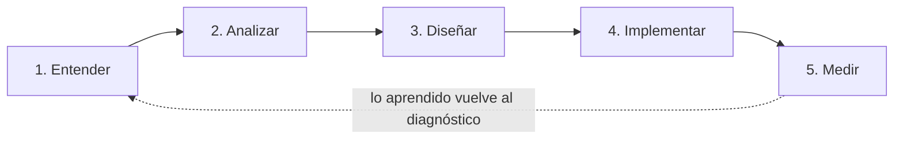

# delivery-playbook

Cómo trabajo en proyectos de automatización, IA aplicada y desarrollo a medida:
la metodología, las plantillas que uso y los controles que paso antes de poner
algo en producción.

## Principio

**Primero el proceso, después la tecnología.** Un proyecto empieza entendiendo
cómo trabaja hoy el negocio y dónde pierde tiempo o dinero. La herramienta se
elige al final, y la IA solo entra cuando hace algo que una regla simple no puede
hacer ([ADR 0002](docs/adr/0002-reglas-antes-que-ia.md)).

## Las cinco fases

| Fase | Pregunta que responde | Entregable | Guía |
| --- | --- | --- | --- |
| 1. Entender | ¿Cómo funciona hoy y dónde duele? | Mapa de procesos y diagnóstico | [01-entender](docs/01-entender.md) |
| 2. Analizar | ¿Qué merece la pena resolver primero? | Lista priorizada con ROI estimado | [02-analizar](docs/02-analizar.md) |
| 3. Diseñar | ¿Cómo lo resolvemos con el mínimo sistema posible? | Propuesta y decisiones técnicas (ADR) | [03-disenar](docs/03-disenar.md) |
| 4. Implementar | ¿Cómo lo ponemos en marcha sin romper nada? | Sistema en producción y traspaso | [04-implementar](docs/04-implementar.md) |
| 5. Medir | ¿Ha funcionado? | Informe de resultados a 30/60/90 días | [05-medir](docs/05-medir.md) |

## Plantillas

| Plantilla | Cuándo se usa |
| --- | --- |
| [Diagnóstico](templates/diagnostico.md) | Primera reunión: entrevista estructurada por áreas del negocio |
| [Propuesta](templates/propuesta.md) | Después del análisis: alcance, coste, plazos y lo que queda fuera |
| [Traspaso (runbook)](templates/traspaso.md) | Al entregar: cómo funciona, cómo se opera y qué hacer si falla |

## Checklists

| Checklist | Antes de… |
| --- | --- |
| [Puesta en producción](checklists/puesta-en-produccion.md) | Activar cualquier sistema con usuarios reales |
| [Agente de IA](checklists/agente-ia.md) | Dejar que un modelo hable con clientes o tome decisiones |
| [Datos y seguridad](checklists/datos-y-seguridad.md) | Tratar datos personales o conectar sistemas del cliente |

## Decisiones

Las decisiones de método están registradas como ADR en [`docs/adr/`](docs/adr/).

## Licencia

[MIT](LICENSE). Úsalo, adáptalo y mejóralo.
